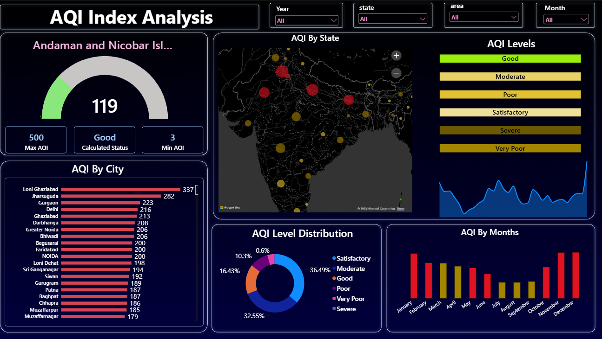

# 🌫️ AQI Index Analysis: India (2015–2025)

An end-to-end data analytics project that cleans, explores and visualises **10 years of daily Air Quality Index (AQI) data** across **295 areas in 32 states and union territories** of India, ending with an interactive **Power BI dashboard**.



---

## 📌 Table of Contents

- [Project Overview](#-project-overview)
- [Objectives](#-objectives)
- [Dataset](#-dataset)
- [Tools & Technologies](#-tools--technologies)
- [Data Cleaning & Validation](#-data-cleaning--validation)
- [Key Insights](#-key-insights)
- [Dashboard Features](#-dashboard-features)
- [Repository Structure](#-repository-structure)
- [How to Run](#-how-to-run)
- [Limitations](#-limitations)
- [Future Improvements](#-future-improvements)
- [Author](#-author)

---

## 📖 Project Overview

Air pollution is one of India's biggest public-health challenges. This project analyses daily AQI readings to answer questions such as:

- How has air quality changed over the last decade?
- Which states and cities are the most and least polluted?
- Which months and seasons are the worst?
- Which pollutants drive poor air quality?

The raw data was inspected and validated in **Python (pandas)**, and the cleaned dataset was used to build a filterable **Power BI** dashboard.

## 🎯 Objectives

1. Understand the structure and quality of the national daily AQI dataset.
2. Validate AQI category labels against the official AQI ranges.
3. Identify yearly, monthly and quarterly trends.
4. Compare states and areas to find pollution hotspots and the cleanest regions.
5. Present the findings in an interactive dashboard (filters: Year, State, Area, Month).

## 🗂️ Dataset

| Item | Detail |
|---|---|
| Records | 425,279 daily observations |
| Period | 1 May 2015 – 19 June 2025 |
| Coverage | 32 states/UTs, 295 areas |
| AQI range | 3 – 500 |

**Main columns:** `date`, `state`, `area`, `number_of_monitoring_stations`, `prominent_pollutants`, `aqi_value`, `air_quality_status`, `unit`

**AQI categories used (Indian AQI bands):**

| AQI | Category |
|---|---|
| 0–50 | Good |
| 51–100 | Satisfactory |
| 101–200 | Moderate |
| 201–300 | Poor |
| 301–400 | Very Poor |
| 401–500 | Severe |

## 🛠️ Tools & Technologies

- **Python** – pandas, matplotlib (Jupyter Notebook)
- **Power BI** – DAX, interactive visuals, slicers, map visual
- **Git & GitHub** – version control

## 🧹 Data Cleaning & Validation

- Checked for duplicate rows and duplicate `date + state + area` combinations: **none found**.
- Converted `date` from `dd-mm-yyyy` text to a proper datetime type.
- Found **141 missing values** in `number_of_monitoring_stations`.
- Recalculated the AQI category from `aqi_value` as `calculated_status` and compared it with the source label: **268 mismatches** (0.06%), mostly boundary values such as AQI 50, 100, 200 and 300.
- Kept `calculated_status` as the single category column, dropped `air_quality_status` and the constant `unit` column, and exported the final dataset (425,279 rows × 7 columns).

## 💡 Key Insights

**Overall**
- Average AQI is **118.66** (median **96**).
- **Satisfactory** (36.49%) and **Moderate** (32.55%) are the most common categories; **Poor, Very Poor and Severe** together make up about **14.5%** of readings.

**Trend over time**
- Average AQI fell from **157 in 2016** to about **103 in 2025** (partial year, data up to 19 June).
- A noticeable dip in 2020, followed by a rise in 2021–2022 and lower levels in 2024–2025.

**Seasonality**
- Worst months: **November (174)** and **December (168)**; cleanest: **August (66)**.
- Q4 has the highest average AQI (154.8), Q3 the lowest (68.0), reflecting the monsoon effect.

**States**
- Most polluted (avg AQI): **Delhi (216)**, **Bihar (166)**, **Himachal Pradesh (160)**, **Uttar Pradesh (160)**, **Haryana (152)**.
- Cleanest: **Mizoram (45)**, **Meghalaya (53)**, **Sikkim (53)**, **Puducherry (56)**.
- Uttar Pradesh recorded the most *Severe* readings (1,055); Haryana the most *Poor* readings (9,136).

**Pollutants**
- **PM10** (~54% of records) and **PM2.5** (~36%) are the most prominent pollutants.

> ⚠️ Areas such as *Loni Ghaziabad* and *Jharsuguda* top the city ranking but have only 1–2 records, so they should be interpreted with caution.

## 📊 Dashboard Features

- **KPI gauge:** average, maximum and minimum AQI with calculated status
- **AQI By State:** bubble map of India
- **AQI By City:** ranked bar chart of average AQI
- **AQI Level Distribution:** donut chart of the six categories
- **AQI By Months:** seasonal pattern at a glance
- **Slicers:** Year, State, Area and Month filter every visual

## 📁 Repository Structure

```
├── RAW_aqi_data.csv                    # Original dataset
├── Aqi_Cleaned_final.csv               # Cleaned dataset used for analysis and Power BI
├── AQI_Cleaned_Final.ipynb             # Data inspection, cleaning and EDA notebook
├── AQI_level_analysis_dashboard.pbix   # Power BI dashboard
├── AQI_level_analysis_dashboard.png    # Dashboard screenshot
├── AQI_Index_Analysis_Report.pdf       # Full project report
└── README.md
```

## ▶️ How to Run

1. **Clone the repository**
   ```bash
   git clone https://github.com/divyainsights99/india-aqi-analysis.git
   cd india-aqi-analysis
   ```
2. **Install the requirements**
   ```bash
   pip install pandas matplotlib jupyter
   ```
3. **Open the notebook**
   ```bash
   jupyter notebook AQI_Cleaned_Final.ipynb
   ```
   Update the file paths inside the notebook so they point to the CSV files in this folder.
4. **Open the dashboard:** open `AQI_level_analysis_dashboard.pbix` in [Power BI Desktop](https://powerbi.microsoft.com/desktop/).

## ⚠️ Limitations

- Monitoring coverage grew from ~2,900 records in 2015 to ~87,000 in 2024, so part of the trend may reflect which areas are monitored, not only changes in air quality.
- Averaging daily AQI hides extreme-pollution days.
- Area-level rankings are affected by very different record counts per area (1 to 3,679).
- Causes of seasonal peaks (crop burning, winter conditions, lockdowns) are context, not conclusions tested in this project.

## 🚀 Future Improvements

- Pollutant-level analysis (PM2.5 vs PM10 by state and season)
- Trend analysis on a fixed set of areas with continuous multi-year data
- Rank areas by number of Poor-or-worse days
- Dashboard fixes: neutral "All India" title on the gauge, status calculated from the average AQI, severity-based colour palette, minimum-records filter on the city chart

## 👩‍💻 Author

**Divya Gupta**
Aspiring Data Analyst · Python · SQL · Power BI · Excel
GitHub: [@divyainsights99](https://github.com/divyainsights99)

---

⭐ If you found this project useful, please consider giving it a star!
